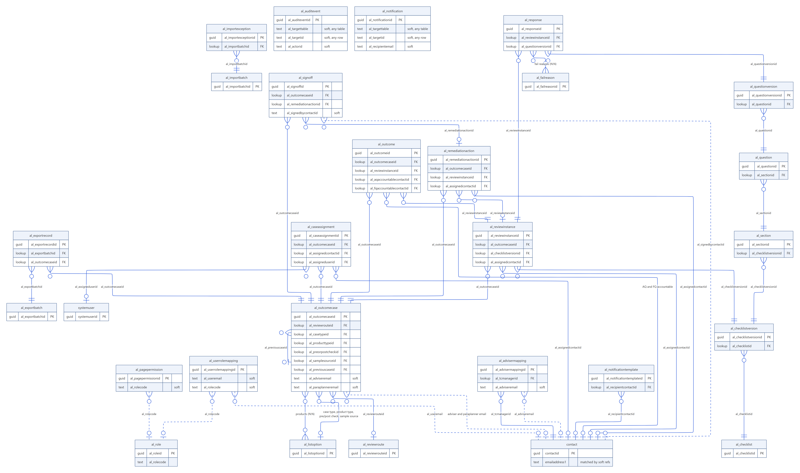

# Outcome Testing data model

The 26 custom tables in the `OutcomeTesting` solution, plus the three platform tables they point
at (`contact`, `systemuser`, `organization`). Read from `src/Entities/*/Entity.xml` and
`src/Other/Relationships/*.xml` on 2026-10-14 (solution 1.0.27.0).

## How to read the diagram

- **Solid line:** a real Dataverse lookup. The label is the lookup column on the table at the
  crow's foot (the "many" side).
- **Dashed line:** a soft reference. A text column holds an id, an email or a code, and the
  plug-ins resolve it in code. Dataverse does not enforce these.
- **`||`** at the parent end means the lookup is required, and **`o|`** means it is optional.
- **`}o--o{`** is a many-to-many relationship through an intersect table.
- **FK** marks a lookup column. A comment of "soft" marks a text reference.

Left out to keep it readable: the standard lookups every table carries (`createdby`,
`modifiedby`, `createdonbehalfby`, `modifiedonbehalfby`, `ownerid`, `owningbusinessunit`,
`owningteam`, `owninguser`), and `organizationid` on the 10 organisation-owned tables. Those are
`al_advisermapping`, `al_checklist`, `al_checklistversion`, `al_failreason`, `al_listoption`,
`al_notificationtemplate`, `al_question`, `al_questionversion`, `al_reviewroute` and
`al_section`.

```mermaid
erDiagram
    %% ---------------- The case and its checks ----------------
    al_outcomecase {
        guid al_outcomecaseid PK
        lookup al_reviewrouteid FK
        lookup al_casetypeid FK
        lookup al_producttypeid FK
        lookup al_preorpostcheckid FK
        lookup al_samplesourceid FK
        lookup al_previouscaseid FK
        text al_adviseremail "soft"
        text al_paraplanneremail "soft"
    }
    al_caseassignment {
        guid al_caseassignmentid PK
        lookup al_outcomecaseid FK
        lookup al_assignedcontactid FK
        lookup al_assigneduserid FK
    }
    al_reviewinstance {
        guid al_reviewinstanceid PK
        lookup al_outcomecaseid FK
        lookup al_checklistversionid FK
        lookup al_assignedcontactid FK
    }
    al_response {
        guid al_responseid PK
        lookup al_reviewinstanceid FK
        lookup al_questionversionid FK
    }
    al_outcome {
        guid al_outcomeid PK
        lookup al_outcomecaseid FK
        lookup al_reviewinstanceid FK
        lookup al_aqaccountablecontactid FK
        lookup al_fqaccountablecontactid FK
    }
    al_remediationaction {
        guid al_remediationactionid PK
        lookup al_outcomecaseid FK
        lookup al_reviewinstanceid FK
        lookup al_assignedcontactid FK
    }
    al_signoff {
        guid al_signoffid PK
        lookup al_outcomecaseid FK
        lookup al_remediationactionid FK
        text al_signedbycontactid "soft"
    }

    %% ---------------- The checklist library ----------------
    al_checklist {
        guid al_checklistid PK
    }
    al_checklistversion {
        guid al_checklistversionid PK
        lookup al_checklistid FK
    }
    al_section {
        guid al_sectionid PK
        lookup al_checklistversionid FK
    }
    al_question {
        guid al_questionid PK
        lookup al_sectionid FK
    }
    al_questionversion {
        guid al_questionversionid PK
        lookup al_questionid FK
    }
    al_failreason {
        guid al_failreasonid PK
    }

    %% ---------------- Reference data ----------------
    al_reviewroute {
        guid al_reviewrouteid PK
    }
    al_listoption {
        guid al_listoptionid PK
    }

    %% ---------------- Import and export ----------------
    al_importbatch {
        guid al_importbatchid PK
    }
    al_importexception {
        guid al_importexceptionid PK
        lookup al_importbatchid FK
    }
    al_exportbatch {
        guid al_exportbatchid PK
    }
    al_exportrecord {
        guid al_exportrecordid PK
        lookup al_exportbatchid FK
        lookup al_outcomecaseid FK
    }

    %% ---------------- People, roles and access ----------------
    contact {
        guid contactid PK
        text emailaddress1 "matched by soft refs"
    }
    systemuser {
        guid systemuserid PK
    }
    al_advisermapping {
        guid al_advisermappingid PK
        lookup al_tcmanagerid FK
        text al_adviseremail "soft"
    }
    al_userrolemapping {
        guid al_userrolemappingid PK
        text al_useremail "soft"
        text al_rolecode "soft"
    }
    al_role {
        guid al_roleid PK
        text al_rolecode
    }
    al_pagepermission {
        guid al_pagepermissionid PK
        text al_rolecode "soft"
    }

    %% ---------------- Messaging and audit ----------------
    al_notificationtemplate {
        guid al_notificationtemplateid PK
        lookup al_recipientcontactid FK
    }
    al_notification {
        guid al_notificationid PK
        text al_targettable "soft, any table"
        text al_targetid "soft, any row"
        text al_recipientemail "soft"
    }
    al_auditevent {
        guid al_auditeventid PK
        text al_targettable "soft, any table"
        text al_targetid "soft, any row"
        text al_actorid "soft"
    }

    %% ---------------- Lookups (solid) ----------------
    al_outcomecase       }o--o| al_reviewroute       : "al_reviewrouteid"
    al_outcomecase       }o--o| al_listoption        : "case type, product type, pre/post check, sample source"
    al_outcomecase       }o--o| al_outcomecase       : "al_previouscaseid"
    al_caseassignment    }o--|| al_outcomecase       : "al_outcomecaseid"
    al_caseassignment    }o--o| contact              : "al_assignedcontactid"
    al_caseassignment    }o--o| systemuser           : "al_assigneduserid"
    al_reviewinstance    }o--|| al_outcomecase       : "al_outcomecaseid"
    al_reviewinstance    }o--|| al_checklistversion  : "al_checklistversionid"
    al_reviewinstance    }o--o| contact              : "al_assignedcontactid"
    al_response          }o--|| al_reviewinstance    : "al_reviewinstanceid"
    al_response          }o--|| al_questionversion   : "al_questionversionid"
    al_outcome           }o--|| al_outcomecase       : "al_outcomecaseid"
    al_outcome           }o--|| al_reviewinstance    : "al_reviewinstanceid"
    al_outcome           }o--o| contact              : "AQ and FQ accountable"
    al_remediationaction }o--|| al_outcomecase       : "al_outcomecaseid"
    al_remediationaction }o--o| al_reviewinstance    : "al_reviewinstanceid"
    al_remediationaction }o--o| contact              : "al_assignedcontactid"
    al_signoff           }o--|| al_outcomecase       : "al_outcomecaseid"
    al_signoff           }o--o| al_remediationaction : "al_remediationactionid"
    al_checklistversion  }o--|| al_checklist         : "al_checklistid"
    al_section           }o--|| al_checklistversion  : "al_checklistversionid"
    al_question          }o--|| al_section           : "al_sectionid"
    al_questionversion   }o--|| al_question          : "al_questionid"
    al_importexception   }o--|| al_importbatch       : "al_importbatchid"
    al_exportrecord      }o--|| al_exportbatch       : "al_exportbatchid"
    al_exportrecord      }o--|| al_outcomecase       : "al_outcomecaseid"
    al_advisermapping    }o--|| contact              : "al_tcmanagerid"
    al_notificationtemplate }o--o| contact           : "al_recipientcontactid"

    %% ---------------- Many-to-many ----------------
    al_response          }o--o{ al_failreason        : "fail reasons (N:N)"
    al_outcomecase       }o--o{ al_listoption        : "products (N:N)"

    %% ---------------- Soft references (dashed) ----------------
    al_outcomecase       }o..o| contact              : "adviser and paraplanner email"
    al_advisermapping    }o..o| contact              : "al_adviseremail"
    al_userrolemapping   }o..o| contact              : "al_useremail"
    al_userrolemapping   }o..o| al_role              : "al_rolecode"
    al_pagepermission    }o..o| al_role              : "al_rolecode"
    al_signoff           }o..o| contact              : "al_signedbycontactid"
```

## Lookups

| Table | Lookup column | Points to | Required | On delete of the parent |
|---|---|---|---|---|
| `al_outcomecase` | `al_reviewrouteid` | `al_reviewroute` | No | Restrict |
| `al_outcomecase` | `al_casetypeid` | `al_listoption` | No | Restrict |
| `al_outcomecase` | `al_producttypeid` | `al_listoption` | No | Restrict |
| `al_outcomecase` | `al_preorpostcheckid` | `al_listoption` | No | Restrict |
| `al_outcomecase` | `al_samplesourceid` | `al_listoption` | No | Restrict |
| `al_outcomecase` | `al_previouscaseid` | `al_outcomecase` (itself) | No | Remove link |
| `al_caseassignment` | `al_outcomecaseid` | `al_outcomecase` | Yes | Restrict |
| `al_caseassignment` | `al_assignedcontactid` | `contact` | No | Remove link |
| `al_caseassignment` | `al_assigneduserid` | `systemuser` | No | Remove link |
| `al_reviewinstance` | `al_outcomecaseid` | `al_outcomecase` | Yes | Restrict |
| `al_reviewinstance` | `al_checklistversionid` | `al_checklistversion` | Yes | Restrict |
| `al_reviewinstance` | `al_assignedcontactid` | `contact` | No | Remove link |
| `al_response` | `al_reviewinstanceid` | `al_reviewinstance` | Yes | **Cascade** (the only one) |
| `al_response` | `al_questionversionid` | `al_questionversion` | Yes | Restrict |
| `al_outcome` | `al_outcomecaseid` | `al_outcomecase` | Yes | Restrict |
| `al_outcome` | `al_reviewinstanceid` | `al_reviewinstance` | Yes | Restrict |
| `al_outcome` | `al_aqaccountablecontactid` | `contact` | No | Remove link |
| `al_outcome` | `al_fqaccountablecontactid` | `contact` | No | Remove link |
| `al_remediationaction` | `al_outcomecaseid` | `al_outcomecase` | Yes | Restrict |
| `al_remediationaction` | `al_reviewinstanceid` | `al_reviewinstance` | No | Restrict |
| `al_remediationaction` | `al_assignedcontactid` | `contact` | No | Remove link |
| `al_signoff` | `al_outcomecaseid` | `al_outcomecase` | Yes | Restrict |
| `al_signoff` | `al_remediationactionid` | `al_remediationaction` | No | Restrict |
| `al_checklistversion` | `al_checklistid` | `al_checklist` | Yes | Restrict |
| `al_section` | `al_checklistversionid` | `al_checklistversion` | Yes | Restrict |
| `al_question` | `al_sectionid` | `al_section` | Yes | Restrict |
| `al_questionversion` | `al_questionid` | `al_question` | Yes | Restrict |
| `al_importexception` | `al_importbatchid` | `al_importbatch` | Yes | Restrict |
| `al_exportrecord` | `al_exportbatchid` | `al_exportbatch` | Yes | Restrict |
| `al_exportrecord` | `al_outcomecaseid` | `al_outcomecase` | Yes | Restrict |
| `al_advisermapping` | `al_tcmanagerid` | `contact` | Yes | Restrict |
| `al_notificationtemplate` | `al_recipientcontactid` | `contact` | No | Remove link |

"Restrict" means the parent row cannot be deleted while a child points at it. "Remove link"
clears the lookup on the child instead.

## Many-to-many relationships

| Relationship | Tables | Intersect table |
|---|---|---|
| `al_failreason_response` | `al_response` and `al_failreason` | `al_al_failreason_al_response` |
| `al_listoption_al_outcomecase_products` | `al_outcomecase` and `al_listoption` | `al_listoption_al_outcomecase_products` |

## Soft references

These columns point at another row as text. Nothing in Dataverse keeps them valid, so a renamed
email or a deleted row leaves them dangling.

| Table | Column | Refers to |
|---|---|---|
| `al_outcomecase` | `al_adviseremail`, `al_paraplanneremail` | The adviser's and paraplanner's `contact.emailaddress1`. People are matched by email, never by name. |
| `al_advisermapping` | `al_adviseremail` | The adviser's `contact.emailaddress1`. Its T&C Manager is a real lookup. |
| `al_userrolemapping` | `al_useremail` | The person's work email. |
| `al_userrolemapping` | `al_rolecode` | `al_role.al_rolecode` |
| `al_pagepermission` | `al_rolecode` | `al_role.al_rolecode` |
| `al_signoff` | `al_signedbycontactid` | The signing `contact`'s id, stamped from the portal user. |
| `al_notification` | `al_targettable` + `al_targetid` | The row that raised the letter: a case, review, remedial action, sign-off or assignment. |
| `al_notification` | `al_recipientemail` | The recipient's address. |
| `al_auditevent` | `al_targettable` + `al_targetid` | The row the audited command acted on, in any table. |
| `al_auditevent` | `al_actorid` | The contact or user who ran the command. |

Two more kinds of text column are not drawn:

- `al_exportrecord` copies the adviser and paraplanner codes and emails at export time. They are
  a snapshot, not a link.
- The `contact` request columns (`al_signoffrequest`, `al_claimrequest`, `al_regraderequest`,
  `al_caseheaderrequest`, `al_accountabilityrequest`) carry a JSON command naming the row to act
  on. A plug-in reads the command and clears the column.
